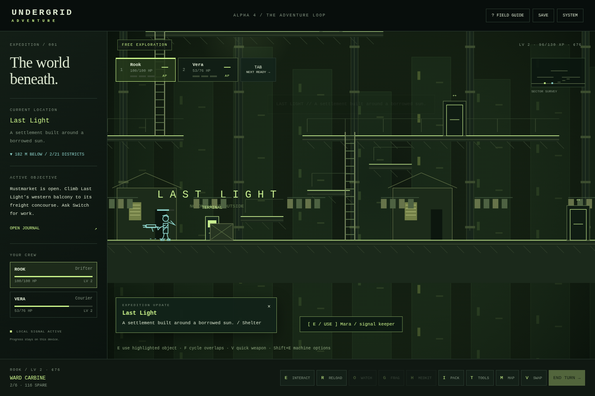

# Undergrid Adventure: Alpha 4 — The Adventure Loop

A standalone, offline side-view survival RPG built from the supplied Adventure alpha and original Undergrid references. Explore **21 connected districts**, recruit a three-person crew, take sixteen linked contracts, restore a freight locomotive and unlock new routes. Customize each fighter with 15 weapon patterns, six armor patterns, field gear, modifications, talents, a callsign and a color. Combat takes place on the platforms and ladders you explore.

**0.5 / Alpha 4:** More forgiving movement and ladders, contextual machinery, local patrol encounters, quick fire/weapon orders, equipment tabs, six active abilities, per-fighter gun calibration, four optional dispatched challenges and three new work-floor mechanisms. The new work uses a separate site; cleared story routes stay clear. See [what changed, limits and next priorities](docs/ALPHA_4.md).

[Download current game](https://github.com/KC2012/undergrid_adventure/raw/refs/heads/main/UNDERGRID_ADVENTURE.html) · [Preserved Alpha 3](releases/UNDERGRID_ADVENTURE_Alpha_3.html) · [Download source ZIP](https://github.com/KC2012/undergrid_adventure/archive/refs/heads/main.zip)

**Ward Bound continuity:** the stakes are a living wage, clean water, old grudges and people worth coming back for. The first Last Light mission still opens the railway. The story keeps the deeper Undergrid lore implied. Existing 0.2, 0.3 and 0.4 saves migrate automatically; export a backup first.

**Play:** open `UNDERGRID_ADVENTURE.html` in a modern desktop or mobile browser. No installation, account, external assets, CDN, or Internet connection is required. Sound is optional and starts muted; enable it in SYSTEM. If your browser restricts local files or storage, serve the directory:

```sh
cd /workspace/undergrid_adventure
python -m http.server 8000 --bind 127.0.0.1
```

Open the served `UNDERGRID_ADVENTURE.html` in your browser. Save storage is specific to the browser and origin; use SYSTEM → EXPORT before switching origins or devices.

## Development

```sh
python tools/build.py
node --check src/data.js
node --check src/game.js
```

- `src/data.js`: hand-authored rooms, platform/ladder graph, NPCs, equipment, enemy archetypes.
- `src/game.js`: state, save validation, exploration, routing, combat and canvas presentation.
- `src/expansion-data.js`: additional authored districts, arsenal, equipment and contracts.
- `src/campaign.js`: save migration, gear/talent effects, jobs, bonds, grudges, crew dock and campaign menus. Its code is inserted inside the engine closure by the build script.
- `src/presentation.js`: shared equipment-driven fighter, weapon paths, animation and preview rendering.
- `src/living-data.js`: five new districts, environmental controls and six new contracts.
- `src/living.js`: machine state, tools, roster, staged boss, audio and migration.
- `src/adventure-data.js`: encounter squads, tiers, abilities, four dispatch jobs and existing-district utilities.
- `src/adventure.js`: movement forgiveness, contextual input, local combat, active abilities, calibration, replay objectives and migration.
- `src/style.css`: responsive terminal UI.
- `src/index.html`: application shell.
- `tools/build.py`: assembles readable sources into the complete portable HTML release.
- `tests/browser_test.py`: browser integration suite (Python Playwright and Chromium required for development testing only).
- `references/`: unmodified supplied games. They are not loaded by the new game.

Run the browser suite while the local server is running:

```sh
python tests/browser_test.py
python tests/expansion_test.py
python tests/visual_test.py
python tests/living_test.py
python tests/adventure_loop_test.py
python tests/adventure_systems_test.py
python tests/dispatch_play_test.py
```

The test URL opts into an isolated harness with `?test`. Normal play exposes no test API. Use the existing checkout in cloud tasks; it is already isolated and does not require a worktree.

See [player guide](docs/PLAYER_GUIDE.md), [design notes](docs/DESIGN.md), [release notes](docs/CHANGELOG.md), and [validation / limitations](docs/TESTING.md). This is a substantially expanded playable campaign foundation, not a finished massive full-length RPG. The validation report separates controlled fixtures, actual browser input, the fresh-opening bot, and normal-AP convoy/dispatch simulations. Extended human playtesting remains outstanding.

## Alpha 4 previews

The opening screenshot comes from the fresh-start test; the equipment view is an interface inspection.



[Equipment tabs](docs/screenshots/alpha4-equipment.png) · [Combat controls](docs/screenshots/alpha4-combat.png) · [Portrait combat](docs/screenshots/alpha4-mobile.png)

[Weapon sheet](docs/screenshots/alpha3-weapons.png) · [Armor silhouettes](docs/screenshots/alpha3-armor.png) · [Previous excavator view](docs/screenshots/alpha3-boss.png)
