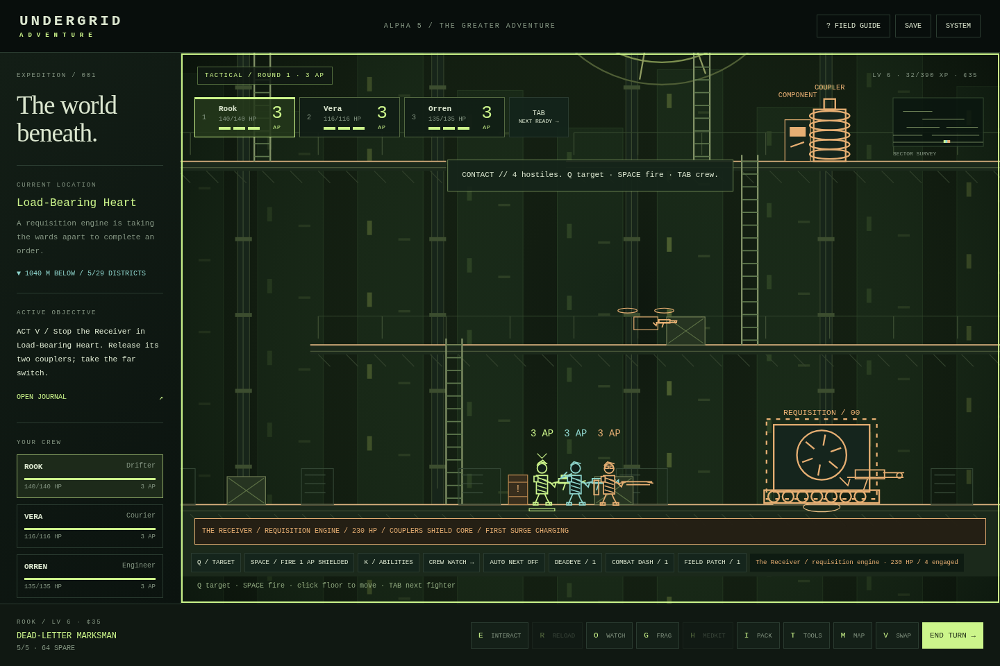

# Undergrid Adventure: Alpha 5 — The Greater Adventure

A standalone, offline side-view survival RPG built from the supplied Adventure alpha and original Undergrid references. Explore **29 story districts**, recruit a three-person crew, take twenty contracts and side quests, restore a freight locomotive and unlock new routes. Customize each fighter with 17 weapon patterns, six armor patterns, field gear, modifications, talents, a callsign and a color. Combat takes place on the platforms and ladders you explore.

**0.6 / Alpha 5:** The Bell Engine becomes Act I of a complete five-stage **Common Line** arc. Restore freight and water, choose public or bonded backing, reach the deep works, reconnect a hidden network, and decide who gets a place in the grid. Eight new permanent regions include the Counterweight Abyss, Cold Foundry, Relay Orchard and Load-Bearing Heart. Three expedition families each span three connected work areas, with seeded patrol/cache/hazard variation, quiet checkpoints, at-risk salvage and optional deep reserves.

[Download current game](https://github.com/KC2012/undergrid_adventure/raw/refs/heads/main/UNDERGRID_ADVENTURE.html) · [Preserved Alpha 4](releases/UNDERGRID_ADVENTURE_Alpha_4.html) · [Download source ZIP](https://github.com/KC2012/undergrid_adventure/archive/refs/heads/main.zip)

See [campaign structure and implemented scope](docs/ALPHA_5.md), [expedition rules](docs/EXPEDITIONS.md), and [player guide](docs/PLAYER_GUIDE.md). The five-stage arc is playable; the eventual multi-hour length target is not established by testing.

**Ward Bound continuity:** the stakes are a living wage, clean water, old grudges and people worth coming back for. The first Last Light mission still opens the railway. The story keeps the deeper Undergrid lore implied. Existing 0.2–0.5 saves migrate automatically; export a backup first.

**Play:** open `UNDERGRID_ADVENTURE.html` in a modern desktop or mobile browser. No installation, account, external assets, CDN, or Internet connection is required. Sound is optional and starts muted; enable it in SYSTEM. If your browser restricts local files or storage, serve the directory:

```sh
cd /workspace/undergrid_adventure
python -m http.server 8000 --bind 127.0.0.1
```

Open the served `UNDERGRID_ADVENTURE.html` in your browser. Save storage is specific to the browser and origin; use SYSTEM → EXPORT before switching origins or devices.

## Development

```sh
python tools/build.py
node --check src/data.js
node --check src/game.js
```

- `src/data.js`: hand-authored rooms, platform/ladder graph, NPCs, equipment, enemy archetypes.
- `src/game.js`: state, save validation, exploration, routing, combat and canvas presentation.
- `src/expansion-data.js`: additional authored districts, arsenal, equipment and contracts.
- `src/campaign.js`: save migration, gear/talent effects, jobs, bonds, grudges, crew dock and campaign menus. Its code is inserted inside the engine closure by the build script.
- `src/presentation.js`: shared equipment-driven fighter, weapon paths, animation and preview rendering.
- `src/living-data.js`: five new districts, environmental controls and six new contracts.
- `src/living.js`: machine state, tools, roster, staged boss, audio and migration.
- `src/adventure-data.js`: encounter squads, tiers, abilities, four dispatch jobs and existing-district utilities.
- `src/adventure.js`: movement forgiveness, contextual input, local combat, active abilities, calibration, replay objectives and migration.
- `src/greater-data.js`: the continuation, new equipment/enemies, eight story regions, twenty jobs and three families of authored expedition layouts.
- `src/greater.js`: additive migration, five-act objectives, charter/ending transactions, expedition escrow/checkpoints, boss rules, journal and regional presentation.
- `src/style.css`: responsive terminal UI.
- `src/index.html`: application shell.
- `tools/build.py`: assembles readable sources into the complete portable HTML release.
- `tests/browser_test.py`: browser integration suite (Python Playwright and Chromium required for development testing only).
- `references/`: unmodified supplied games. They are not loaded by the new game.

Run the browser suite while the local server is running:

```sh
python tests/browser_test.py
python tests/expansion_test.py
python tests/visual_test.py
python tests/living_test.py
python tests/adventure_loop_test.py
python tests/adventure_systems_test.py
python tests/dispatch_play_test.py
python tests/greater_test.py
python tests/greater_play_test.py
```

The test URL opts into an isolated harness with `?test`. Normal play exposes no test API. Use the existing checkout in cloud tasks; it is already isolated and does not require a worktree.

See [player guide](docs/PLAYER_GUIDE.md), [design notes](docs/DESIGN.md), [release notes](docs/CHANGELOG.md), and [validation / limitations](docs/TESTING.md). This is a complete compact campaign arc within an expanding RPG foundation. The validation report separates controlled fixtures, real browser input, a fresh full-introduction bot, a prepared continuation through the ending, and normal-AP convoy/dispatch/expedition simulations. Human full-campaign balance and actual playtime remain unmeasured.

## Alpha 5 previews

These new-region images are staged visual inspections. Actual completed gameplay simulations are documented separately in TESTING.md.



[Counterweight Abyss](docs/screenshots/alpha5-abyss.png) · [Relay Orchard](docs/screenshots/alpha5-orchard.png) · [Kettle Junction](docs/screenshots/alpha5-junction.png) · [Expedition board](docs/screenshots/alpha5-expeditions.png) · [Campaign journal](docs/screenshots/alpha5-campaign.png) · [Portrait combat](docs/screenshots/alpha5-mobile-combat.png)

[Previous weapon sheet](docs/screenshots/alpha3-weapons.png) · [Alpha 4 equipment tabs](docs/screenshots/alpha4-equipment.png)
