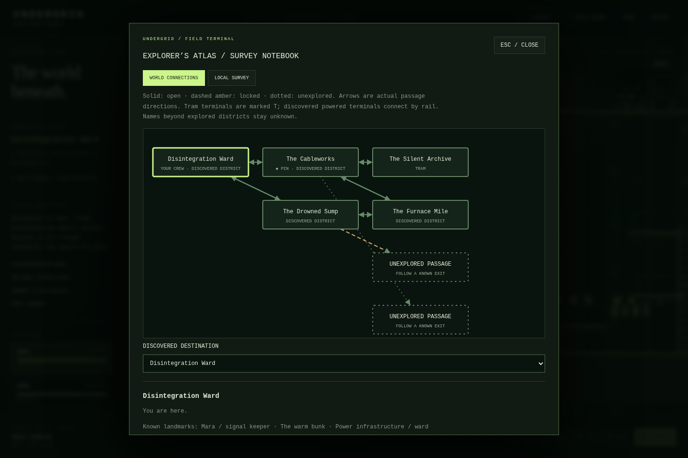
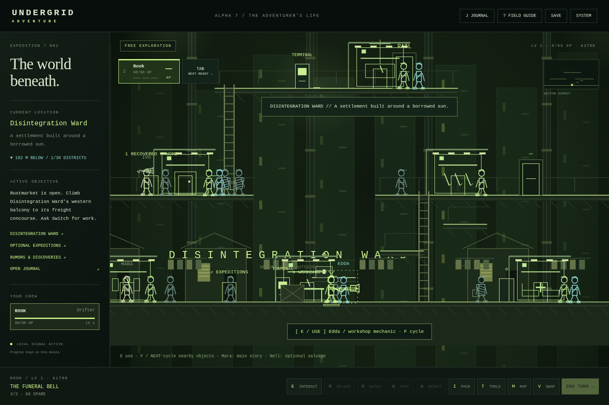
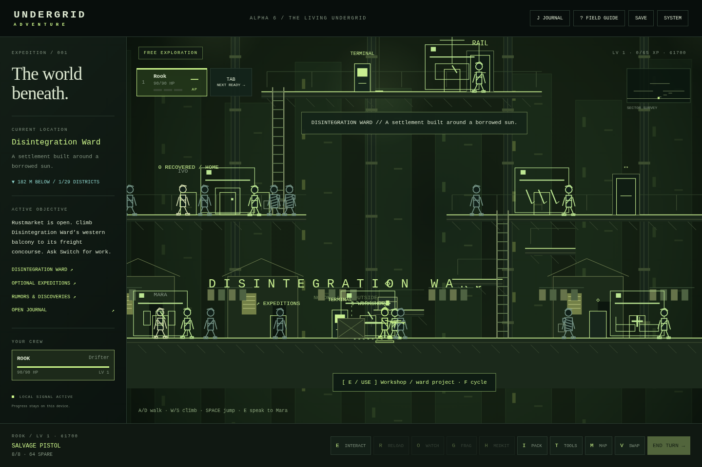

# Undergrid Adventure: Alpha 10 — Strange Industry

**New:** explore a transformed Vent Cathedral and Relay Orchard, enter the Walking Foundry, face five industrial enemy types, operate consequential machinery and recover three rare field patterns. [Alpha 10 guide, enemy counterplay and limitations](docs/ALPHA_10.md).

Run, jump broken catwalks, descend through real hatches, and travel with **Rook plus three companions**. Discover the Cableworks service workshop, recruit Nim, Brass and Ilex, and resolve existing local work with repair, evidence, negotiation or supplies. [Alpha 9 scope, geometry, roster, quests and compatibility](docs/ALPHA_9.md).

Chart discovered district connections, survey local platforms and ladders, plan known routes, and inspect shared combat/movement forecasts. [Atlas guide](docs/ATLAS.md) · [Combat and balance](docs/ALPHA_8_COMBAT.md) · [Original reference review](docs/ALPHA_8_COMBAT_REVIEW.md).

Develop Disintegration Ward through seven visible facilities, follow rumors to twelve exceptional equipment patterns, and explore five optional expedition families. [Alpha 8 scope and limitations](docs/ALPHA_8.md), [settlement guide](docs/SETTLEMENT.md), [equipment catalog](docs/EXCEPTIONAL_EQUIPMENT.md), and [weapon audit](docs/WEAPON_AUDIT.md).

Restore exceptional weapon frames through Edda’s workshop, bring a missing engineer home, meet named residents and regional travelers, and choose different expedition work orders. [Gameplay audit](docs/ALPHA_7_AUDIT.md) · [Regional event guide](docs/REGIONAL_EVENTS.md).

A standalone, offline side-view survival RPG built from the supplied Adventure alpha and original Undergrid references. Explore **31 persistent districts**, recruit seven companions, travel with four fighters, take twenty-four contracts and side quests, restore a freight locomotive and unlock new routes. Customize each fighter with 23 weapon patterns, eight armor patterns, field gear, modifications, talents, a callsign and a color. Combat takes place on the platforms and ladders you explore.

**Previous 0.6 / Alpha 5:** The Bell Engine becomes Act I of a complete five-stage **Common Line** arc. Restore freight and water, choose public or bonded backing, reach the deep works, reconnect a hidden network, and decide who gets a place in the grid. Eight new permanent regions include the Counterweight Abyss, Cold Foundry, Relay Orchard and Load-Bearing Heart. Three expedition families each span three connected work areas, with seeded patrol/cache/hazard variation, quiet checkpoints, at-risk salvage and optional deep reserves.

[Download current game](https://github.com/KC2012/undergrid_adventure/raw/refs/heads/alpha10-strange-industry/UNDERGRID_ADVENTURE.html) · [Preserved Alpha 9](releases/UNDERGRID_ADVENTURE_Alpha_9.html) · [Preserved Alpha 8](releases/UNDERGRID_ADVENTURE_Alpha_8.html) · [Preserved Alpha 7](releases/UNDERGRID_ADVENTURE_Alpha_7.html) · [Preserved Alpha 6](releases/UNDERGRID_ADVENTURE_Alpha_6.html) · [Preserved Alpha 5](releases/UNDERGRID_ADVENTURE_Alpha_5.html) · [Preserved Alpha 4](releases/UNDERGRID_ADVENTURE_Alpha_4.html) · [Download source ZIP](https://github.com/KC2012/undergrid_adventure/archive/refs/heads/alpha10-strange-industry.zip)

See [campaign structure and implemented scope](docs/ALPHA_5.md), [expedition rules](docs/EXPEDITIONS.md), and [player guide](docs/PLAYER_GUIDE.md). The five-stage arc is playable; the eventual multi-hour length target is not established by testing.

**Ward Bound continuity:** the stakes are a living wage, clean water, old grudges and people worth coming back for. The first Disintegration Ward mission still opens the railway. The story keeps the deeper Undergrid lore implied. Existing saves through Alpha 8 migrate automatically; export a backup first.

**Play:** open `UNDERGRID_ADVENTURE.html` in a modern desktop or mobile browser. No installation, account, external assets, CDN, or Internet connection is required. Sound is optional and starts muted; enable it in SYSTEM. If your browser restricts local files or storage, serve the directory:

```sh
cd /workspace/undergrid_adventure
python -m http.server 8000 --bind 127.0.0.1
```

Open the served `UNDERGRID_ADVENTURE.html` in your browser. Save storage is specific to the browser and origin; use SYSTEM → EXPORT before switching origins or devices.

## Development

```sh
python tools/build.py
node --check src/data.js
node --check src/game.js
```

- `src/data.js`: hand-authored rooms, platform/ladder graph, NPCs, equipment, enemy archetypes.
- `src/game.js`: state, save validation, exploration, routing, combat and canvas presentation.
- `src/expansion-data.js`: additional authored districts, arsenal, equipment and contracts.
- `src/campaign.js`: save migration, gear/talent effects, jobs, bonds, grudges, crew dock and campaign menus. Its code is inserted inside the engine closure by the build script.
- `src/presentation.js`: shared equipment-driven fighter, weapon paths, animation and preview rendering.
- `src/living-data.js`: five new districts, environmental controls and six new contracts.
- `src/living.js`: machine state, tools, roster, staged boss, audio and migration.
- `src/adventure-data.js`: encounter squads, tiers, abilities, four dispatch jobs and existing-district utilities.
- `src/adventure.js`: movement forgiveness, contextual input, local combat, active abilities, calibration, replay objectives and migration.
- `src/greater-data.js`: the continuation, new equipment/enemies, eight story regions, twenty jobs and five families of authored expedition layouts.
- `src/ward-data.js`: settlement projects, exceptional catalog, rumors and authored optional work.
- `src/ward.js`: project transactions/construction, services, relic escrow, discovery journal and ambient presentation.
- `src/greater.js`: additive migration, five-act objectives, charter/ending transactions, expedition escrow/checkpoints, boss rules, journal and regional presentation.
- `src/life-data.js`: named residents, restoration commissions, regional encounters, work orders and the optional Pump Test Annex.
- `src/life.js`: life-state migration/validation, event choices, stock/services, restoration, home displays and risk/return guidance.
- `src/atlas.js`: progressive survey state, connected/local maps, real route planning, pins and notes.
- `src/tactics.js`: shared forecasts, tactical presentation, suppression, industrial interactions and bounded AI.
- `src/style.css`: responsive terminal UI.
- `src/index.html`: application shell.
- `tools/build.py`: assembles readable sources into the complete portable HTML release.
- `tests/browser_test.py`: browser integration suite (Python Playwright and Chromium required for development testing only).
- `references/`: unmodified supplied games. They are not loaded by the new game.

Run the browser suite while the local server is running:

```sh
python tests/browser_test.py
python tests/expansion_test.py
python tests/visual_test.py
python tests/living_test.py
python tests/adventure_loop_test.py
python tests/adventure_systems_test.py
python tests/dispatch_play_test.py
python tests/greater_test.py
python tests/greater_play_test.py
python tests/ward_test.py
python tests/ward_play_test.py
python tests/life_test.py
python tests/atlas_test.py
python tests/tactics_test.py
python tests/cartography_play_test.py
python tests/cartography_ui_test.py
```

The test URL opts into an isolated harness with `?test`. Normal play exposes no test API. Use the existing checkout in cloud tasks; it is already isolated and does not require a worktree.

See [player guide](docs/PLAYER_GUIDE.md), [design notes](docs/DESIGN.md), [release notes](docs/CHANGELOG.md), and [validation / limitations](docs/TESTING.md). This is a complete compact campaign arc within an expanding RPG foundation. The validation report separates controlled fixtures, real browser input, a fresh full-introduction bot, a prepared continuation through the ending, and normal-AP convoy/dispatch/expedition simulations. Human full-campaign balance and actual playtime remain unmeasured.

## Alpha 8 previews

The atlas images come from the fresh navigation bot’s genuine survey. Tactical views are controlled real-input inspections. [Validation and limitations](docs/TESTING.md) separate fixtures from playthroughs.



[Local survey](docs/screenshots/alpha8-atlas-local.png) · [Portrait map](docs/screenshots/alpha8-atlas-mobile.png) · [Desktop aim feedback](docs/screenshots/alpha8-aim-desktop.png) · [Touch aim feedback](docs/screenshots/alpha8-aim-tablet.png)

## Preserved Alpha 7 previews

The developed Ward and restoration ledger are staged inspections; the fresh-return screenshot comes from the actual optional restoration/repeat-expedition bot.



[Fresh restoration route](docs/screenshots/alpha7-restoration.png) · [Edda’s ledger](docs/screenshots/alpha7-ledger.png) · [Tablet risk report](docs/screenshots/alpha7-risk-tablet.png) · [Compact active-boss warning](docs/screenshots/alpha7-boss-mobile.png)

## Preserved Alpha 6 previews

These settlement and gallery images are staged inspections. The workshop view is from the fresh optional-adventure bot. [Testing evidence](docs/TESTING.md) distinguishes them.



[Earned workshop](docs/screenshots/alpha6-workshop.png) · [Equipped arsenal gallery](docs/screenshots/alpha6-gallery.png) · [Portrait development screen](docs/screenshots/alpha6-mobile.png)

## Preserved Alpha 5 previews

These new-region images are staged visual inspections. Actual completed gameplay simulations are documented separately in TESTING.md.


[Counterweight Abyss](docs/screenshots/alpha5-abyss.png) · [Relay Orchard](docs/screenshots/alpha5-orchard.png) · [Kettle Junction](docs/screenshots/alpha5-junction.png) · [Expedition board](docs/screenshots/alpha5-expeditions.png) · [Campaign journal](docs/screenshots/alpha5-campaign.png) · [Portrait combat](docs/screenshots/alpha5-mobile-combat.png)

[Previous weapon sheet](docs/screenshots/alpha3-weapons.png) · [Alpha 4 equipment tabs](docs/screenshots/alpha4-equipment.png)

Alpha 9 sources: `src/geometry.js` provides shared solid sections, apertures, trajectory collision, physical movement and follower recovery; `src/open-data.js` authors four district refinements and three companions; `src/open.js` provides discoveries, recruitment, local choices and sparse persistent crew reactions. See [verification](docs/TESTING.md).

## Alpha 9 previews

[Four-person Cableworks exploration](docs/screenshots/alpha9-crew.png) · [Phone controls](docs/screenshots/alpha9-phone.png) · [Tablet controls](docs/screenshots/alpha9-tablet.png). [Current testing report](docs/TESTING.md).

Alpha 10 sources: `src/industry-data.js` authors the new branch, machinery, field patterns and enemy types; `src/industry.js` supplies industrial transactions, saved outcomes, telegraphed attacks and procedural environment/enemy art. [Before/after views and testing](docs/TESTING.md).
